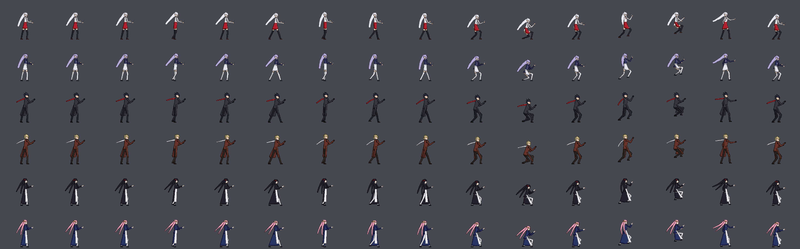

# mugenlike

一个用 Godot 4.7 写的可扩展 2D 格斗游戏底座（白模）。参考《街头霸王》《罪恶装备》《拳皇》的共通结构，
逻辑层确定性、整数运算、可存读档（为回滚联网预留），规则差异做成可替换模块。第一套参考规则是街霸风 6 键。

设计分析见 [docs/fighting-core-analysis.md](docs/fighting-core-analysis.md)，进度记录见 [docs/progress.md](docs/progress.md)。

## 占位角色
三个原创角色（Kagura / Volk / Mio）的像素精灵由 `tools/spritegen/` 程序化生成（Python + Pillow），
每个角色两套配色，可随时重新生成：`python3 tools/spritegen/spritegen.py`



## 运行
用 Godot 4.7 打开工程，运行主场景 `scenes/training.tscn`。

| 操作 | P1 | P2 |
|---|---|---|
| 移动 | WASD | 方向键 |
| LP MP HP | U I O | 小键盘 7 8 9 |
| LK MK HK | J K L | 小键盘 4 5 6 |

| 键 | 功能 |
|---|---|
| F1 | 判定框显示（蓝 受击 / 红 攻击 / 绿 投 / 黄 推挤） |
| F2 / F3 | 存档 / 读档（整场状态） |
| F4 / F5 | 暂停 / 暂停时单帧步进 |
| F6 / Shift+F6 | 重置到中央 / 重置到版边 |
| F7 | 精灵 ↔ 白模 |
| F8 / F9 | 切换 P1 / P2 角色 |
| F10 | 训练模式 ↔ 对战模式（三局两胜） |
| F11 | 资源常满（训练） |
| F12 | 显示/隐藏调试信息 |
| Alt+Enter | 全屏 / 窗口（窗口任意大小都按 16:9 等比缩放，多余部分黑边） |
| 1 / 2 / 3 | 假人模式（玩家/站/蹲/跳/录制/回放）/ 自动防御 / 录制↔回放 |

训练模式默认假人是"站立"，要用 P2 键盘操作请按 1 切到 player。

默认规则模板为街头霸王 6（见 [docs/decisions.md](docs/decisions.md)）。通用操作（面朝右）：LP+LK 投 · 66/44 冲刺 ·
两键同按 = OD 版必杀（2 格 Drive）· 236236 + 键 = 超必杀（1 格超杀槽）。

| 角色 | 定位 | 体格 | 招式 |
|---|---|---|---|
| Kagura | 速攻 | 体力 9000、走/冲最快、体型小 | 236K 裂空斩 · 214P 影步（穿身）· 623K 月轮 · 空中 214K 坠星（上段）· 236236K 千刃 · 轻→中→重 Gatling |
| Volk | 投技 | 体力 11000、最慢、体型大 | 360P 钢铁粉碎（不可拆指令投，起跳预备中也能出）· 214P 野牛冲撞（霸体）· 623P 铁锤 · 236236P 西伯利亚坠落 · 5HK 霸体 |
| Mio | 远程 | 体力 9500、后退快、普攻最长 | 236P 纸符 · 空中 236P 落符（斜下）· 214P 封印（设置物）· 623K 缎带旋 · 236236P 纸吹雪（多段） |
| dummy | 参考 | 标准 | 236P 波动 · 623P 升龙 · 214K 突进踢 · 5MP>HP（白模，测试基准） |

## 导入月姬格斗（MUGEN）人物
可以把 MUGEN 人物的精灵和逐帧判定盒导入本地使用（素材不入库），见 [docs/mugen-import.md](docs/mugen-import.md)。

## 测试
```bash
godot --headless --path . -s res://tests/run_all.gd
```
`tests/test_*.gd` 中所有 `test_` 开头的方法都会被执行；可加 `-- combat` 只跑文件名包含 combat 的测试。
MUGEN 导入器的测试：`python3 -m unittest discover -s tools/mugen -p "test_*.py"`

## 目录
- `core/` 纯逻辑仿真（不依赖场景树）
- `view/` 表现层，只读取仿真状态
- `input/` 本机键盘/手柄输入
- `characters/` `stages/` 角色与舞台数据
- `rulesets/sf_like/` 街霸风规则模块（公共状态：移动、受击、防御、倒地、被投）
- `characters/shared/` 共用招式表（帧数据）
- `tools/` 精灵生成器、截图工具、输入脚本
- `tests/` 无头测试
